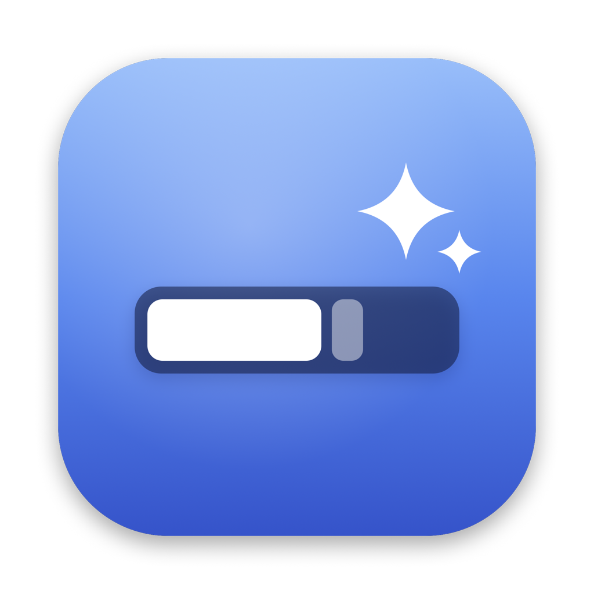
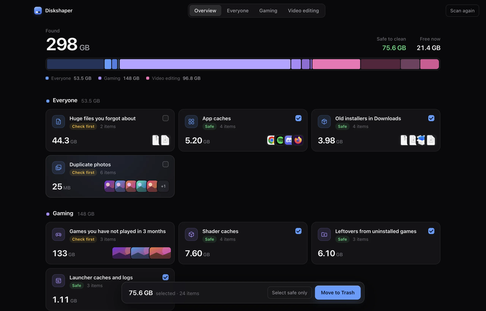

<p align="center">
  <a href="https://hollowbit.dev/diskshaper/"></a>
</p>

<h1 align="center">Diskshaper</h1>

<p align="center"><b>See what's eating your storage.</b></p>
<p align="center">Clean only what's safe, always to the Trash or Recycle Bin, so every clean can be undone.</p>

<p align="center">
  <a href="https://github.com/hollowbit-dev/diskshaper/releases/latest"></a>
  
  
  <a href="LICENSE"></a>
</p>

<p align="center">
  <a href="https://hollowbit.dev/diskshaper/download.html"></a>
  <a href="https://hollowbit.dev/diskshaper/tools/"></a>
</p>

<p align="center"></p>

## What it does

Diskshaper scans your drive in a few seconds and sorts what it finds into plain groups:

- **Gaming:** shader caches, Steam and Epic leftovers after uninstalling, unfinished downloads, launcher caches, games you have not played in 3 months (Steam, Epic, Heroic), empty and full CrossOver bottles.
- **Video editing:** Premiere Pro, After Effects, DaVinci Resolve, Final Cut and CapCut caches, render previews and auto-saves next to your projects, duplicate footage, old exports.
- **Everyone:** app caches, developer tool downloads, old installers and zips, duplicate photos, huge forgotten files, old screen recordings.

Every group says what it is and is labelled **Safe** (rebuilt or downloadable again) or **Check first**. Only Safe items are ticked for you, and everything you clean goes to the Trash or Recycle Bin, so it can be undone.

## Privacy

The only network request is a once-a-day check of GitHub for a newer version number, which you can turn off on the start screen; nothing about you or your files is sent. The app only looks in your user folders, app caches and game libraries, never in macOS or Windows system folders.

## Install

Get the installer from the [website](https://hollowbit.dev/diskshaper/download.html) or the [latest release](https://github.com/hollowbit-dev/diskshaper/releases/latest).

- **Mac:** open the .dmg and drag Diskshaper to Applications. The first time, right-click it and choose **Open**, because the app isn't signed yet.
- **Windows:** run the installer. If SmartScreen appears, click **More info**, then **Run anyway**.

With Homebrew:

```sh
brew tap hollowbit-dev/tap
brew trust hollowbit-dev/tap
brew install --cask diskshaper
```

## Build from source

```bash
npm install
npm start            # run the app
npm run scan         # print a scan in the terminal (reads only)
npm run dist         # Mac (arm64 + x64) and Windows installers into dist/
npm run site         # website into docs/
npm test             # end-to-end checks
```

`DISKSHAPER_DEMO=1 npm start` shows made-up results (used for screenshots); in demo mode cleaning never touches real files.

## More free apps from Hollowbit

- **[Melodyshaper](https://hollowbit.dev/melodyshaper/)**: hum a tune, make a song
- **[Clipshaper](https://hollowbit.dev/clipshaper/)**: long videos to short clips
- **[Captionshaper](https://hollowbit.dev/captionshaper/)**: offline auto subtitles
- **[Lightshaper](https://hollowbit.dev/lightshaper/)**: free photo editor
- **[Fileshaper](https://hollowbit.dev/fileshaper/)**: compress, convert, sign PDFs
- **[Writeshaper](https://hollowbit.dev/writeshaper/)**: offline writing assistant
- **[Moveshaper](https://hollowbit.dev/moveshaper/)**: move to a new computer
- **[Startshaper](https://hollowbit.dev/startshaper/)**: find out why your PC is slow
- **[Fuseduo](https://fuseduo.com/)**: automate your Mac apps

## Licence

MIT.

---

<p align="center"><sub>Made by <a href="https://hollowbit.dev">Hollowbit Studio</a>. If Diskshaper helped you, a ⭐ helps other people find it.</sub></p>
