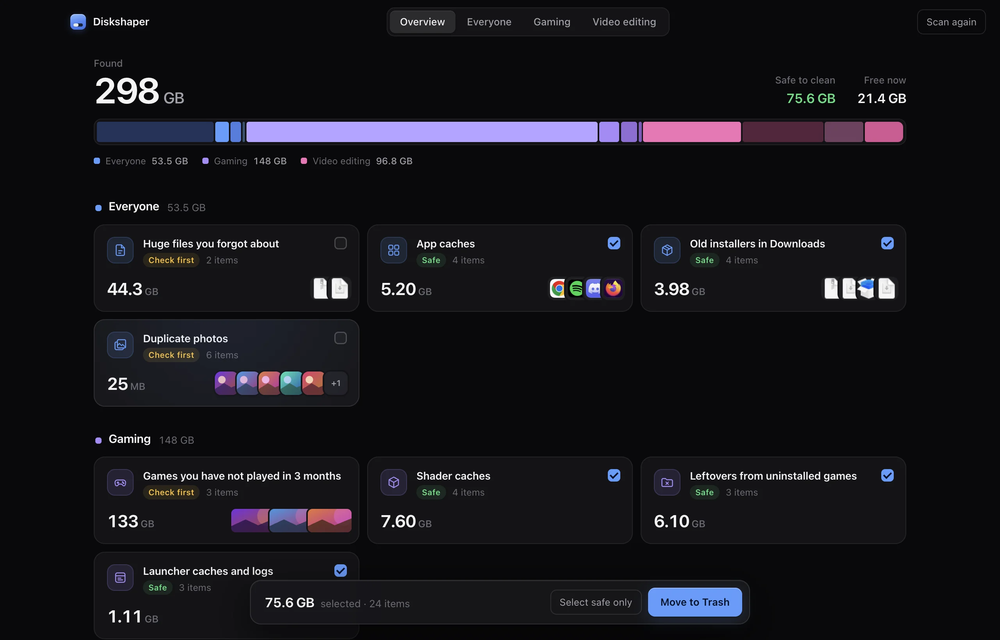

# Diskshaper

See what's eating your storage and clean only what's safe. A free storage cleaner for Mac and Windows by [Hollowbit Studio](https://hollowbit.dev).

**[Download](https://hollowbit.dev/diskshaper/download.html)** · [Website](https://hollowbit.dev/diskshaper/) · [Duplicate photo finder](https://hollowbit.dev/diskshaper/tools/)



Diskshaper scans your drive in a few seconds and sorts what it finds into plain groups:

- **Gaming:** shader caches, Steam and Epic leftovers after uninstalling, unfinished downloads, launcher caches, games you have not played in 3 months (Steam, Epic, Heroic), empty and full CrossOver bottles.
- **Video editing:** Premiere Pro, After Effects, DaVinci Resolve, Final Cut and CapCut caches, render previews and auto-saves next to your projects, duplicate footage, old exports.
- **Everyone:** app caches, developer tool downloads, old installers and zips, duplicate photos, huge forgotten files, old screen recordings.

Every group says what it is and is labelled **Safe** (rebuilt or downloadable again) or **Check first**. Only Safe items are ticked for you, and everything you clean goes to the Trash or Recycle Bin, so it can be undone.

## Privacy

The app makes no network requests. It only looks in your user folders, app caches and game libraries, never in macOS or Windows system folders.

## Build from source

```bash
npm install
npm start            # run the app
npm run scan         # print a scan in the terminal (reads only)
npm run dist         # Mac (arm64 + x64) and Windows installers into dist/
npm run site         # website into docs/
npm test             # end-to-end checks
```

`DISKSHAPER_DEMO=1 npm start` shows made-up results (used for screenshots); in demo mode cleaning never touches real files.

## Licence

MIT
